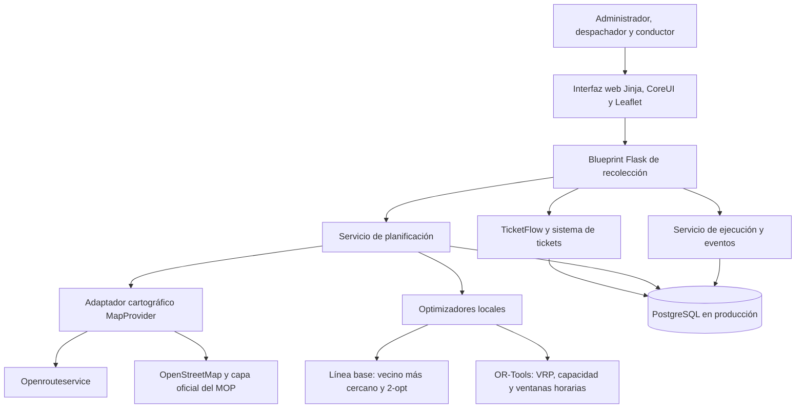

Autoría de Luis Fontecilla

# Optimización de rutas para camiones recolectores

Proyecto de título orientado al desarrollo de una plataforma web para planificar, publicar y actualizar rutas de camiones recolectores a partir de solicitudes registradas en un sistema de tickets existente.

La solución utilizará TicketFlow como aplicación base, incorporará información geográfica, restricciones operacionales y algoritmos de optimización para reducir recorridos innecesarios, tiempos improductivos y visitas fallidas.

## Estado del proyecto

El proyecto se encuentra en fase de diseño y preparación de la implementación. Se han definido el alcance inicial, los requisitos, la arquitectura, el modelo de datos, la estrategia cartográfica y el plan de validación.

Todavía no se ha iniciado la programación del módulo de recolección.

## Problema

Una planificación estática puede enviar un camión a puntos que todavía no están disponibles, utilizar una secuencia de visitas ineficiente o ignorar restricciones como capacidad, prioridad y ventanas horarias.

El sistema actual de tickets permite registrar requerimientos, pero no administra coordenadas, vehículos, jornadas, versiones de ruta ni resultados de optimización. Tampoco permite comparar una ruta de referencia con una propuesta calculada mediante un algoritmo.

## Objetivo general

Diseñar e implementar una plataforma web que apoye la planificación y optimización de rutas de recolección, integrando solicitudes existentes, información geográfica y restricciones operacionales, con el fin de reducir distancia recorrida, tiempo improductivo y costo operacional sin disminuir el cumplimiento del servicio.

## Aplicación base

El motor de tickets se encuentra en:

```text
C:\Users\fonte\Desktop\ticketflow-community-main
```

TicketFlow es una aplicación existente construida con:

- Python y Flask.
- Flask-SQLAlchemy y Flask-Migrate.
- Flask-Login para autenticación.
- Jinja para renderizado de vistas.
- CoreUI para la interfaz.
- SQLite como base predeterminada de desarrollo.
- Configuración preliminar para bases de datos externas.

La funcionalidad de rutas se incorporará como un módulo independiente dentro de TicketFlow. No se desarrollará una segunda aplicación desconectada ni se reemplazará el sistema de tickets existente.

## Arquitectura propuesta

La arquitectura separa la interfaz, las reglas de negocio, los proveedores cartográficos, la optimización y la persistencia. Esta separación permite cambiar un proveedor externo o una estrategia de optimización sin reescribir el sistema completo.



## Componentes

### 1. TicketFlow

TicketFlow continuará siendo la fuente de verdad de las solicitudes. Los modelos `Ticket` y `Cliente` entregarán la identificación, prioridad, descripción, dirección y datos generales del requerimiento.

Cada ticket de recolección tendrá una relación única con una entidad operacional que agregará los datos necesarios para planificarlo. Esta estrategia evita duplicar el motor de tickets y mantiene trazabilidad entre la solicitud original y su ejecución.

### 2. Módulo de recolección

Se agregará un blueprint separado, previsto en:

```text
apps/recoleccion/
```

El módulo contendrá:

- Modelos de dominio para recolección.
- Rutas y endpoints HTTP.
- Formularios y validaciones.
- Servicios de mapas, planificación, optimización y métricas.
- Vistas de administración, despacho y conductor.
- Pruebas unitarias, de integración y de extremo a extremo.

La lógica nueva no debe concentrarse en `apps/home/routes.py`. Ese archivo solo recibirá cambios mínimos de navegación o integración cuando sean necesarios.

### 3. Interfaz web

La interfaz conservará la arquitectura actual de TicketFlow:

- Flask y Jinja para renderizado en el servidor.
- CoreUI para estructura visual.
- Leaflet para visualización cartográfica.
- Diseño adaptable a escritorio y dispositivos móviles.
- Vistas diferenciadas según rol.

No se incorporará React, Vue ni una aplicación móvil nativa durante el MVP.

Las principales vistas serán:

- Solicitudes de recolección.
- Validación de ubicaciones.
- Gestión de vehículos.
- Creación de jornadas.
- Planificación y comparación de rutas.
- Mapa de la ruta publicada.
- Ruta vigente del conductor.
- Historial de versiones y eventos.

### 4. Adaptador cartográfico

No existe una única API pública chilena gratuita que entregue mapa base, geocodificación vial, matrices, rutas y optimización. Por este motivo se utilizará una integración híbrida.

El backend expondrá una interfaz interna denominada `MapProvider`. La primera implementación será `OpenRouteServiceProvider` y entregará:

- Geocodificación directa y reversa.
- Matriz de tiempos y distancias.
- Ajuste de coordenadas a la red vial cuando corresponda.
- Geometría GeoJSON de una ruta ordenada.

La clave de openrouteservice permanecerá únicamente en el servidor.

El mapa web utilizará:

- [OpenStreetMap](https://www.openstreetmap.org/) como mapa base para desarrollo y demostraciones de bajo volumen.
- [Límites administrativos del Ministerio de Obras Públicas](https://rest-sit.mop.gob.cl/arcgis/rest/services/MAPA_BASE/LIMITES/MapServer) como capa territorial chilena opcional.
- [Leaflet](https://leafletjs.com/) para representación de capas, marcadores y rutas.

La aplicación deberá respetar la [política de uso de teselas de OpenStreetMap](https://operations.osmfoundation.org/policies/tiles/), mantener la atribución visible y permitir cambiar el proveedor mediante configuración.

### 5. Motor de optimización

La optimización se ejecutará localmente en el backend. Openrouteservice se utilizará para obtener información vial, pero no reemplazará el algoritmo principal del proyecto.

Se implementará una interfaz `RouteOptimizer` con dos estrategias iniciales:

#### Línea base

- Vecino más cercano con desempate determinista.
- Mejora 2-opt cuando no viole restricciones.
- Resultado reproducible para comparar con la propuesta optimizada.

#### Optimización con OR-Tools

- Uno o más vehículos.
- Capacidad máxima por vehículo.
- Demanda estimada por punto.
- Duración de atención.
- Ventanas horarias opcionales.
- Punto inicial y final.
- Prioridades.
- Penalización por paradas no atendidas.
- Límite configurable de tiempo de búsqueda.

El sistema no afirmará que cada resultado es el óptimo absoluto. Debe registrar si la solución fue exitosa, parcial, inviable o interrumpida por límite de tiempo.

La función objetivo inicial combinará:

```text
Costo total = tiempo o distancia de viaje
            + penalización por parada no atendida
            + penalización por atraso
            + penalización asociada a la prioridad
```

Las ponderaciones serán configurables y deberán justificarse mediante la evaluación del proyecto.

### 6. Persistencia

La aplicación mantendrá dos modalidades:

- SQLite para desarrollo local y pruebas automatizadas.
- PostgreSQL para producción en el VPS.

PostGIS se incorporará si la implementación necesita consultas geográficas dentro de la base de datos. Si el MVP solo requiere almacenar y validar coordenadas, podrá comenzar con latitud y longitud explícitas y conservar PostGIS como evolución documentada.

El esquema se gestionará con Flask-Migrate. No se dependerá únicamente de `db.create_all` para producción.

Las entidades previstas son:

- Solicitud de recolección.
- Punto de recolección.
- Vehículo.
- Jornada.
- Ruta.
- Versión de ruta.
- Parada de ruta.
- Evento operacional.
- Ejecución de optimización.
- Caché cartográfica.

Las versiones publicadas serán inmutables. Un recalculo generará una versión nueva y conservará las paradas ya completadas.

### 7. Roles y autorización

Además de los roles existentes de TicketFlow, el módulo agregará:

- Administrador: acceso completo.
- Despachador: solicitudes, vehículos, jornadas, optimización y publicación.
- Conductor: consulta de su ruta vigente y registro de eventos autorizados.

La autorización se aplicará en el servidor. Un conductor no podrá acceder a rutas asignadas a otra persona mediante cambios en la URL.

### 8. Servicios de aplicación

El módulo separará al menos los siguientes servicios:

- Integración y normalización de tickets.
- Geocodificación y validación de puntos.
- Obtención y caché de matrices de viaje.
- Construcción del problema de optimización.
- Ejecución de algoritmos.
- Publicación y versionado de rutas.
- Registro idempotente de eventos.
- Cálculo de métricas.

Las llamadas externas no se realizarán desde modelos SQLAlchemy ni desde plantillas.

## Flujo principal

1. TicketFlow registra o recibe un ticket.
2. El despachador lo clasifica como solicitud de recolección.
3. El sistema obtiene la dirección del cliente y crea un punto pendiente de validación.
4. El punto se geocodifica o se corrige manualmente.
5. El despachador registra demanda, disponibilidad, duración y ventana horaria.
6. Se crea una jornada y se seleccionan solicitudes y vehículos.
7. El proveedor cartográfico entrega la matriz vial.
8. La línea base calcula una ruta de referencia.
9. OR-Tools calcula una propuesta con restricciones.
10. El sistema compara distancia, duración, capacidad y solicitudes no asignadas.
11. El despachador revisa el mapa y publica una versión.
12. El conductor consulta la secuencia vigente y registra eventos.
13. Un cambio operacional puede generar un recalculo de las paradas pendientes.
14. El cierre de la jornada produce métricas para la evaluación.

## Variables de entorno previstas

```text
ORS_API_KEY=
ORS_BASE_URL=
ORS_GEOCODE_BASE_URL=
ORS_PROFILE=driving-hgv
MAP_TILE_URL=https://tile.openstreetmap.org/{z}/{x}/{y}.png
MAP_TILE_ATTRIBUTION=OpenStreetMap contributors
CHILE_LIMITS_SERVICE_URL=https://rest-sit.mop.gob.cl/arcgis/rest/services/MAPA_BASE/LIMITES/MapServer
MAP_HTTP_TIMEOUT_SECONDS=10

DB_ENGINE=postgresql+psycopg
DB_NAME=ticketflow
DB_HOST=postgres
DB_PORT=5432
DB_USERNAME=ticketflow
DB_PASS=
```

Las claves y contraseñas reales no deben almacenarse en el repositorio ni enviarse al navegador.

## Despliegue previsto

La versión de producción se desplegará en un VPS Debian mediante:

- Gunicorn como servidor de aplicación.
- Nginx como proxy inverso.
- HTTPS con renovación automática de certificados.
- PostgreSQL con acceso restringido.
- Servicios o contenedores con reinicio controlado.
- Migraciones ejecutadas antes de iniciar la nueva versión.
- Respaldos cifrados fuera del VPS.
- Rotación de registros y monitoreo básico.
- Cortafuegos con únicamente los puertos necesarios.

El despliegue real no forma parte de la primera iteración de desarrollo, pero la aplicación debe quedar preparada y documentada para ese entorno.

## Resiliencia

- La aplicación debe iniciar aunque la clave cartográfica no esté configurada.
- Sin proveedor externo debe permitirse ingresar coordenadas manualmente.
- Las pruebas utilizarán proveedores simulados y matrices estáticas.
- Una falla de geocodificación dejará el punto en revisión.
- Una falla de optimización conservará la última ruta publicada.
- Una cuota agotada se informará sin exponer datos internos.
- Las llamadas externas utilizarán timeout y reintentos limitados.
- Los eventos del conductor tendrán identificadores idempotentes.

## Seguridad

- HTTPS en producción.
- Contraseñas almacenadas mediante derivación segura.
- Autorización aplicada en el servidor.
- Protección CSRF en operaciones de escritura.
- Consultas parametrizadas mediante SQLAlchemy.
- Secretos fuera del repositorio.
- Auditoría de publicación, recalculo y eventos.
- Registros sin claves ni datos personales innecesarios.
- Respaldos y restauraciones comprobadas.

## Métricas

El sistema distinguirá valores planificados de valores ejecutados y mostrará:

- Distancia de la línea base.
- Distancia de la propuesta optimizada.
- Duración estimada de ambas alternativas.
- Diferencia absoluta y porcentual.
- Servicios asignados y no asignados.
- Utilización de capacidad.
- Tiempo de ejecución del optimizador.
- Cantidad de recalculos y versiones.
- Servicios completados, omitidos y con incidencia.

No se informará ahorro monetario, consumo ni emisiones sin datos y supuestos documentados.

## Alcance del MVP

### Incluido

- Integración con tickets existentes.
- Ubicaciones y coordenadas validadas.
- Vehículos y conductores.
- Jornadas y versiones de ruta.
- Mapa interactivo.
- Línea base y optimización con OR-Tools.
- Capacidad y ventanas horarias.
- Publicación y ejecución de una ruta.
- Recalculo de paradas pendientes.
- Métricas básicas.
- SQLite para desarrollo y PostgreSQL para producción.
- Pruebas automatizadas sin dependencia de internet.

### Excluido

- Sensores IoT.
- Predicción mediante inteligencia artificial.
- Telemetría continua.
- Aplicación móvil nativa.
- Navegación giro a giro propia.
- Facturación.
- Optimización continua de flotas de gran escala.
- Despliegue productivo durante la primera iteración.

## Estructura prevista dentro de TicketFlow

```text
ticketflow-community-main/
|-- apps/
|   |-- authentication/
|   |-- home/
|   `-- recoleccion/
|       |-- __init__.py
|       |-- models.py
|       |-- routes.py
|       |-- forms.py
|       |-- services/
|       |   |-- maps.py
|       |   |-- optimization.py
|       |   |-- planning.py
|       |   `-- metrics.py
|       `-- templates/recoleccion/
|-- migrations/
|-- tests/
|-- docs/
|-- docker-compose.yml
|-- requirements.txt
`-- README.md
```

Los nombres finales podrán ajustarse durante la implementación, pero se debe conservar la separación de responsabilidades.

## Documentación del proyecto

- [Alcance y requisitos](docs/alcance-y-requisitos.md)
- [Arquitectura inicial](docs/arquitectura-inicial.md)
- [Modelo de datos conceptual](docs/modelo-datos-conceptual.md)
- [Plan de validación](docs/plan-de-validacion.md)
- [Decisiones pendientes](docs/decisiones-pendientes.md)
- [Prompt de desarrollo para OpenCode](PROMPT_OPENCODE_DESARROLLO_MVP.md)
- Documento formal: `Proyecto_de_Titulo_Optimizacion_Rutas.docx`

## Criterios de éxito preliminares

- Un ticket genera como máximo una solicitud de recolección activa.
- Cada parada utilizada por el optimizador posee coordenadas validadas.
- La solución respeta capacidad y ventanas horarias o informa inviabilidad.
- Toda parada aparece asignada una vez o queda explícitamente no asignada.
- La clave cartográfica no llega al navegador.
- La ruta publicada conserva una versión inmutable.
- El conductor solo accede a su asignación.
- El recalculo mantiene las paradas completadas.
- Las pruebas no dependen de internet.
- La evaluación compara línea base, propuesta y ejecución.

## Próximo hito

Ejecutar la primera iteración definida en el prompt para OpenCode y construir la vertical completa desde un ticket sintético hasta la publicación y ejecución de una ruta. Antes de utilizar datos reales se deben confirmar el contrato del sistema de tickets, las restricciones operacionales, la unidad de capacidad y la línea base de evaluación.
